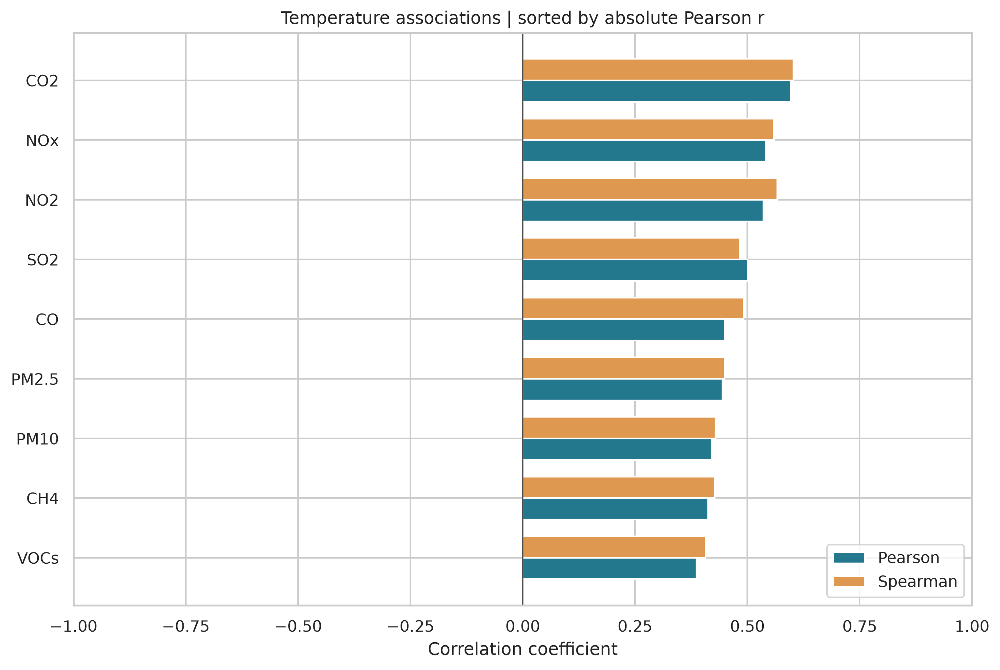
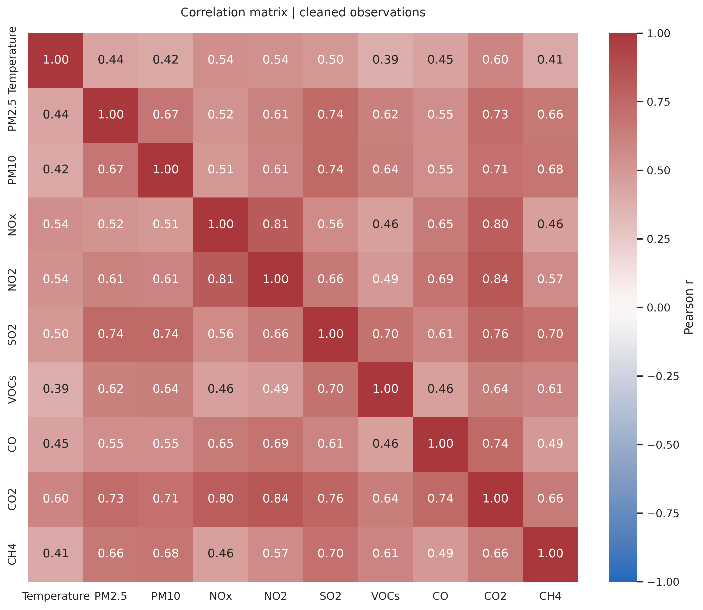
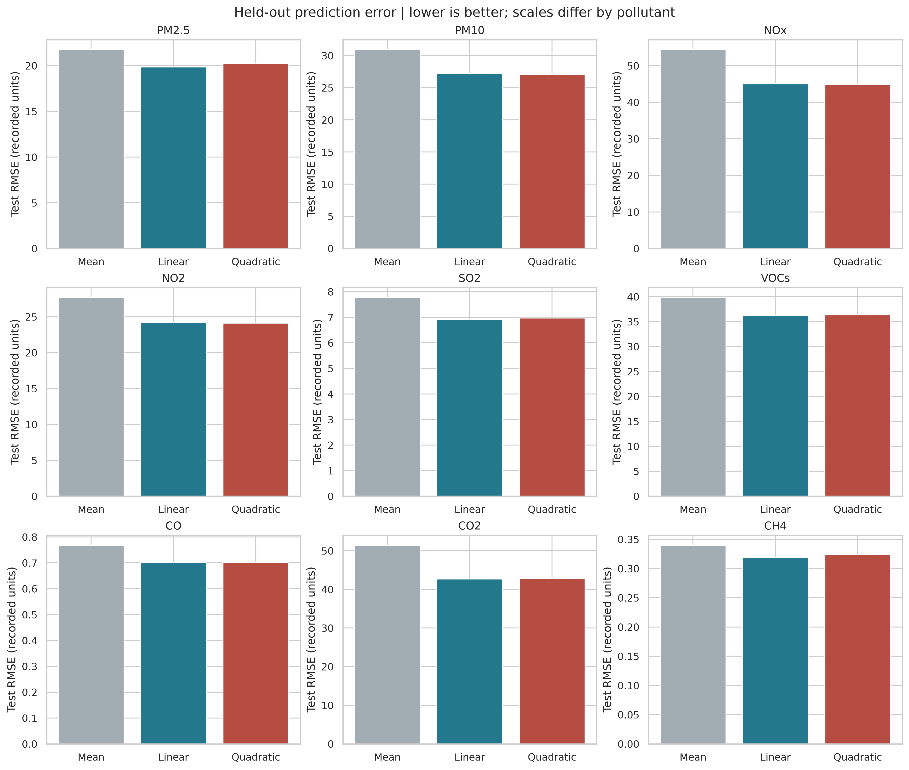

# Air Quality and Temperature Analysis

[](https://colab.research.google.com/github/kashevchenko/air-quality-temperature-analysis/blob/main/notebooks/temperature_air_pollution_analysis.ipynb)

## Project overview

A reproducible Python study of the statistical relationship between temperature and nine atmospheric pollutant variables. The project combines data auditing, exploratory analysis, multiple-testing correction, robust linear inference and held-out predictive evaluation. It is designed as a university Data Science project and a transparent portfolio example.

**Research question:** Is there a statistically significant association between temperature and pollutant concentration?

**Objectives:** characterize the supplied data, quantify linear and monotonic associations, estimate linear regression slopes and compare linear and quadratic prediction without conflating association with causation.

## Dataset and access

The supplied CSV contains **500 observations and 10 numeric columns**: `Temperature`, `PM2.5`, `PM10`, `NOx`, `NO2`, `SO2`, `VOCs`, `CO`, `CO2`, and `CH4`.

**Raw data are not distributed:** their source and redistribution rights have not been established. Obtain an authorized copy and place it at `data/air_quality_dataset.csv`. The Colab notebook offers a CSV upload fallback. The code prefers a dataset already present in the repository checkout if one is added later with permission. Exact reproduction is conditional on access to the same input; the repository is not a self-contained data release.

No collection dates, geography, measurement units, sensor information or sampling design were supplied. Whether observations are measured or simulated is unknown. Column labels are treated as supplied variable names, not verified environmental metadata. See [data documentation](data/README.md).

### Auditing and cleaning

- No missing values, failed numeric conversions, nonfinite values or duplicate records were found.
- Four rows have negative pollutant readings: one NOx, one NO2 and two SO2. These rows are excluded by a declared convention, leaving **496 records**. Unknown calibration or correction procedures prevent interpreting every negative reading as an error.
- Twelve retained records have at least one 1.5-IQR flag. Extreme values are not automatically deleted.
- The original input is never modified. Full audits and its SHA-256 are in [data_quality.json](results/data_quality.json).
- A [sensitivity analysis](results/correlation_sensitivity_keep_negatives.csv) repeats correlations with negative readings retained.

## Hypotheses and statistical methodology

For each of nine pollutants:

- **H0:** population Pearson correlation with temperature equals zero (no linear association).
- **H1:** population Pearson correlation is nonzero (two-sided linear association).

Descriptive statistics include count, mean, median, sample standard deviation, minimum, maximum and quartiles. Pearson and Spearman coefficients and two-sided p-values are reported. Benjamini–Hochberg false-discovery-rate correction is applied separately to nine primary Pearson tests and nine secondary Spearman tests, at 0.05. Heatmap entries outside those families are descriptive.

Full-sample ordinary least squares estimates `Y = beta0 + beta1 × Temperature + error`. The coefficient table contains intercepts, slopes, HC3 robust standard errors, t-based p-values, individual 95% confidence intervals and in-sample R². A separate BH family corrects the nine robust slope p-values. Confidence intervals are not simultaneous intervals. HC3 addresses heteroskedasticity, not serial dependence or confounding.

Pearson p-values rely on distributional assumptions; independence is also required for the usual inferential interpretation. Neither independence nor representativeness can be established from this file. Significance is conditional on those assumptions and is not evidence of causation.

## Predictive models

Compare a training-mean baseline, linear regression and a degree-two polynomial regression, `Y = beta0 + beta1 × Temperature + beta2 × Temperature² + error`.

A single reproducible 80/20 split (seed 42) yields **396 training and 100 test records**, shared by all pollutants and models. Polynomial scaling is fitted on training observations only. R², RMSE and MAE are evaluated on untouched test observations. Full-sample inferential fits and train-only predictive fits serve different purposes. Split membership and training coefficients are exported. Degree two is prespecified, with no test-driven hyperparameter tuning.

## Key findings

All nine primary Pearson and all nine secondary Spearman tests remain significant after their respective BH corrections. Pearson coefficients range from **0.3863 (VOCs)** to **0.5968 (CO2)**. The three largest absolute Pearson associations are CO2, NOx and NO2.

| Pollutant | Pearson r | BH-adjusted p | Spearman rho | Test R²: linear | Test R²: quadratic |
|---|---:|---:|---:|---:|---:|
| PM2.5 | 0.4448 | 2.73e-25 | 0.4493 | 0.1662 | 0.1338 |
| PM10 | 0.4208 | 1.36e-22 | 0.4290 | 0.2214 | 0.2286 |
| NOx | 0.5408 | 2.27e-38 | 0.5589 | 0.3003 | 0.3058 |
| NO2 | 0.5357 | 1.03e-37 | 0.5663 | 0.2285 | 0.2313 |
| SO2 | 0.5006 | 1.84e-32 | 0.4831 | 0.2059 | 0.1962 |
| VOCs | 0.3863 | 4.23e-19 | 0.4069 | 0.1743 | 0.1671 |
| CO | 0.4497 | 8.38e-26 | 0.4914 | 0.1502 | 0.1507 |
| CO2 | 0.5968 | 3.12e-48 | 0.6025 | 0.3044 | 0.3002 |
| CH4 | 0.4130 | 8.36e-22 | 0.4275 | 0.1186 | 0.0868 |

For CO2, the full-sample slope is **10.3441** per recorded temperature unit (HC3 95% CI **9.0302 to 11.6579**), with in-sample R² **0.3562**. Physical units were not supplied.

The quadratic model has lower test RMSE than the linear model for **4 of 9 pollutants** (PM10, NOx, NO2 and CO); improvements are small on this split. Linear regression has lower RMSE for the other five. Both models outperform the training-mean baseline on RMSE for all nine variables. This does not establish general superiority of either model. MAE can favor a different model; all metrics are retained in [model_comparison.csv](results/model_comparison.csv).

Retaining all 500 rows in the correlation sensitivity analysis leaves all nine Pearson and Spearman BH decisions significant. These are dataset-specific associations; unknown provenance prevents claims about real-world environmental mechanisms.

## Visualizations

All six figures are exported at 300 DPI with consistent styling and no assumed physical units.





Additional figures: [distributions](results/distributions.png), [full-sample linear fits](results/regression_analysis.png), and [train-only linear versus quadratic curves](results/polynomial_comparison.png).

## Installation and execution

Tested with Python 3.12. Dependencies, including transitive versions, are pinned in `requirements.txt`.

```bash
git clone https://github.com/kashevchenko/air-quality-temperature-analysis.git
cd air-quality-temperature-analysis
python -m venv .venv
source .venv/bin/activate  # Windows: .venv\Scripts\activate
pip install -r requirements.txt
# Place your authorized CSV at data/air_quality_dataset.csv first.
python src/analysis.py
python -m unittest discover -s tests -v
```

For another data location or output directory:

```bash
python src/analysis.py --data /path/to/air_quality_dataset.csv --output results
```

Paths default to the repository root, independent of the current working directory. Missing data produce an explicit error, never a synthetic replacement. Results are overwritten on rerun; the raw input is not.

## Google Colab

1. Click the **Open in Colab** badge above.
2. Run the notebook from top to bottom. Its setup clones the public repository if no local checkout is present, then installs requirements.
3. Upload one authorized CSV when prompted. No Google Drive mount or hardcoded `/content` path is required.
4. Read the methodology, tables and figures in sequence. Outputs are written to the checkout's `results` directory.

Locally, the notebook can run from the root or `notebooks/` directory. Set `AIR_QUALITY_DATA` to override the input path. The original [Untitled0.ipynb](Untitled0.ipynb) is preserved as a historical draft; use the new notebook for reproducible work.

## Project structure

```text
├── README.md
├── .gitignore
├── requirements.txt
├── data/
│   ├── README.md
│   └── air_quality_dataset.csv       # local only; not redistributed
├── notebooks/
│   └── temperature_air_pollution_analysis.ipynb
├── src/
│   └── analysis.py
├── tests/
│   └── test_analysis.py
├── results/
│   ├── correlation_matrix.png
│   ├── temperature_correlations.png
│   ├── regression_analysis.png
│   ├── polynomial_comparison.png
│   ├── model_comparison.png
│   ├── distributions.png
│   ├── correlation_results.csv
│   ├── correlation_sensitivity_keep_negatives.csv
│   ├── descriptive_statistics.csv
│   ├── linear_regression_results.csv
│   ├── model_coefficients.csv
│   ├── model_comparison.csv
│   ├── split_assignments.csv
│   └── data_quality.json
└── Untitled0.ipynb                   # preserved original draft
```

## Technologies and quality assurance

Python, NumPy, pandas, SciPy, statsmodels, scikit-learn, Matplotlib, Seaborn and Jupyter. Tests check input integrity, cleaning invariants, missing-file/schema errors, correlation outputs, reproducible disjoint splits, original-scale polynomial coefficients, robust intervals and valid 300-DPI figures/CSV outputs. See [validation record](VALIDATION.md) for execution details and limitations.

## Limitations

- Dataset provenance, units and measured versus simulated status are unknown; no environmental mechanism or population claim can be established.
- No time/location identifiers are available to check dependence, adjust for seasonality, construct grouped splits or evaluate future forecasts.
- Temperature alone omits potential confounders. Correlation does not imply causation.
- Complete-case selection and negative-reading exclusions can bias results; sensitivity results address only one cleaning choice.
- A single split is a limited comparison without uncertainty intervals for performance differences. It should not be used to claim definitive model superiority.
- Raw-data access is required to reproduce numerical findings. The Colab web runtime itself may differ from the tested local environment.

## Author and license

Author: [kashevchenko](https://github.com/kashevchenko).

No license is granted. A `LICENSE` file is intentionally absent because the owner has not selected a license. Dataset redistribution is likewise pending confirmation of rights.
